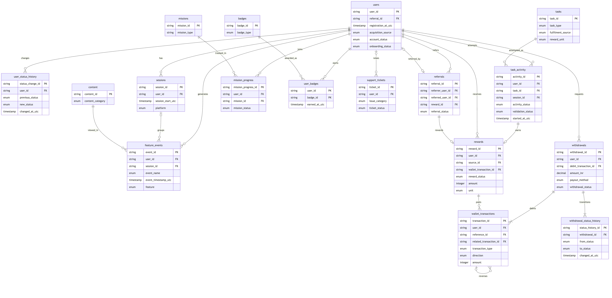
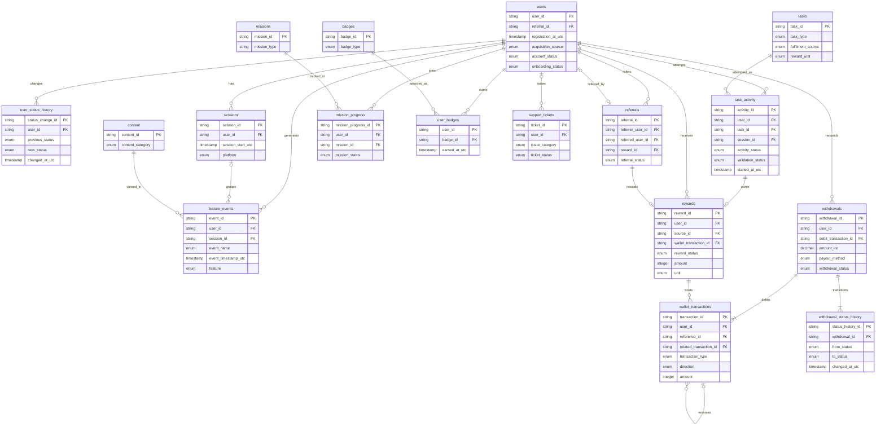

# 10 · Logical Data Model

> **Status:** proposed specification. No event, field, table or KPI in this document has been verified as implemented in VELOOP production (see Assumption A-001). Facts taken from official VELOOP pages cite a source ID from the Source & Verification Register (deliverable 19).

The model has 17 entities. It covers the 8 required entities (Users, Tasks, Task Activity, Rewards, Wallet Transactions, Withdrawals, Referrals, Feature Events) plus status-history tables, sessions, missions, badges, support tickets and content. Each optional entity is justified below.

## H4 ER diagram

Vector version: [`diagrams/er_diagram.svg`](diagrams/er_diagram.svg).

The source is [`diagrams/er_diagram.mmd`](diagrams/er_diagram.mmd), and the Mermaid code below also renders on GitHub:

## H1/H2 Primary and foreign keys

| entity | description | primary_key | foreign_keys | grain | justification |
| --- | --- | --- | --- | --- | --- |
| users | One row per VELOOP account (pseudonymous analytics view). | user_id | referral_id → referrals.referral_id | account | Core entity; every other entity hangs off user_id. |
| user_status_history | One row per account status change. | status_change_id | user_id → users.user_id | status change | Needed because account_status is a snapshot (gap G04). |
| sessions | One row per session. | session_id | user_id → users.user_id | session | Session-level analysis and returning users. |
| feature_events | One row per tracked event (event envelope; properties in a JSON column). | event_id | user_id → users.user_id; session_id → sessions.session_id | event | Raw behavioural record. |
| tasks | One row per configured task/offer. | task_id | none | task config | Dimension for task activity. |
| task_activity | One row per user attempt at a task. | activity_id | user_id → users.user_id; task_id → tasks.task_id; session_id → sessions.session_id | attempt | Transaction-level task lifecycle (C1). |
| rewards | One row per reward decision. | reward_id | user_id → users.user_id; source_id → task_activity \| feature_events \| referrals \| mission_progress.activity_id \| event_id \| referral_id \| mission_progress_id; wallet_transaction_id → wallet_transactions.transaction_id | reward | Separates activity from credit (C3). |
| wallet_transactions | One row per ledger movement (append-only). | transaction_id | user_id → users.user_id; reference_id → rewards \| withdrawals.reward_id \| withdrawal_id; related_transaction_id → wallet_transactions.transaction_id | ledger movement | Wallet transaction model (D1). |
| withdrawals | One row per withdrawal request. | withdrawal_id | user_id → users.user_id; debit_transaction_id → wallet_transactions.transaction_id | request | Withdrawal lifecycle (D2). |
| withdrawal_status_history | One row per withdrawal status transition. | status_history_id | withdrawal_id → withdrawals.withdrawal_id | transition | Stage durations and impossible-transition checks. |
| referrals | One row per referral relationship. | referral_id | referrer_user_id → users.user_id; referred_user_id → users.user_id; reward_id → rewards.reward_id | referral | Referral funnel (E1). |
| missions | One row per configured mission. | mission_id | none | mission config | Justified: missions are live per official help center. |
| mission_progress | One row per user per mission attempt (users M:N missions). | mission_progress_id | user_id → users.user_id; mission_id → missions.mission_id | user-mission | Mission completion rate. |
| badges | One row per configured badge. | badge_id | none | badge config | Justified: badges are live per official help center. |
| user_badges | One row per badge earned by a user (users M:N badges). | user_id, badge_id | user_id → users.user_id; badge_id → badges.badge_id | user-badge | Badge engagement. |
| support_tickets | One row per support request. | ticket_id | user_id → users.user_id | ticket | Support KPIs. |
| content | One row per help-center article. | content_id | none | article | Help-center engagement. |

## H3 Relationships

| parent | child | cardinality | via | note |
| --- | --- | --- | --- | --- |
| users | sessions | 1:N | user_id | A user has many sessions; a session belongs to one user. |
| users | feature_events | 1:N | user_id | Event relationship: every event belongs to one user. |
| sessions | feature_events | 1:N | session_id | Event relationship: client events belong to one session. |
| users | user_status_history | 1:N | user_id | Each status change belongs to one user. |
| users | task_activity | 1:N | user_id | A user makes many attempts. |
| tasks | task_activity | 1:N | task_id | users M:N tasks resolved through task_activity. |
| task_activity | rewards | 1:0..1 | rewards.source_id = activity_id (source_type = task) | At most one reward per attempt (idempotency_key). |
| users | rewards | 1:N | user_id | A user has many rewards. |
| rewards | wallet_transactions | 1:0..N | wallet_transactions.reference_id = reward_id | Transaction relationship: credit, then optional reversal/adjustment. |
| wallet_transactions | wallet_transactions | 1:0..N | related_transaction_id | Transaction relationship: reversal, adjustment, refund and exchange pairs point to the original row. |
| users | wallet_transactions | 1:N | user_id | A wallet has many movements. |
| users | withdrawals | 1:N | user_id | A user can request many withdrawals. |
| withdrawals | wallet_transactions | 1:1..2 | debit_transaction_id; refund via reference_id | Exactly one redemption_debit; one refund if rejected/reversed. |
| withdrawals | withdrawal_status_history | 1:N | withdrawal_id | One row per transition. |
| users | referrals (as referrer) | 1:N | referrer_user_id | A user can refer many people. |
| users | referrals (as referred) | 1:0..1 | referred_user_id | A user is referred at most once. |
| referrals | rewards | 1:0..1 | referrals.reward_id | One referral reward on conversion. |
| users | mission_progress | 1:N | user_id | users M:N missions via mission_progress. |
| missions | mission_progress | 1:N | mission_id |  |
| users | user_badges | 1:N | user_id | users M:N badges via user_badges. |
| badges | user_badges | 1:N | badge_id |  |
| users | support_tickets | 1:N | user_id | Tickets may be anonymous (user_id optional). |
| content | feature_events | 1:N | properties.content_id | help_article_viewed events reference content. |

### Key design decisions

* **Activity is separate from reward** (`task_activity` → `rewards`), so "activity occurred" can never be confused with "reward credited" (C3).
* **The wallet is an append-only ledger.** A reversal is a new row pointing to the original (`related_transaction_id`); nothing is updated in place. Balances are always the sum of the ledger.
* **Polymorphic source.** `rewards.source_id` points to `task_activity`, `feature_events` (daily, spin, badge), `referrals` or `mission_progress`, selected by `source_type`. The validator and QC-06 check each branch separately (J2 tests R13–R15).
* **Many-to-many:** users↔tasks through `task_activity`, users↔missions through `mission_progress`, users↔badges through `user_badges` (composite key).
* **Status history tables** exist because current-state columns cannot answer "when" questions (gaps G04).
* **Referral rows exist before the referred user does**, so `referred_user_id` is nullable until registration. A user can be referred at most once.
