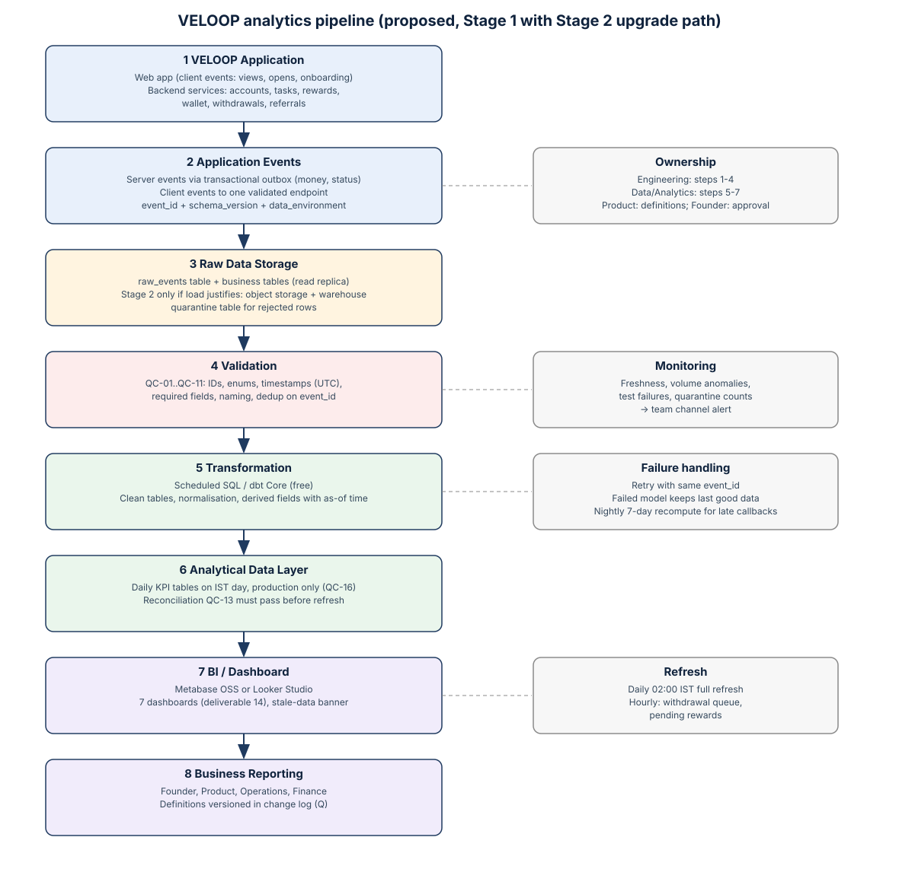

# 16 · Data Pipeline & Operating Model

> **Status:** proposed specification. No event, field, table or KPI in this document has been verified as implemented in VELOOP production (see Assumption A-001). Facts taken from official VELOOP pages cite a source ID from the Source & Verification Register (deliverable 19).

## Principle: practical now, scalable when justified

VELOOP does not yet have production analytics volume (brief, section 35). A warehouse, streaming platform or paid CDP would cost money and need maintenance without improving any decision today. The proposal is therefore built in **two stages**:

* **Stage 1 (now):** collect events into the existing application database, transform them with scheduled SQL, and show them in a free BI tool. Most of the cost is engineering time.
* **Stage 2 (only when needed):** move raw events to object storage and a columnar warehouse when there is evidence: queries slowing the production database, raw events growing past what a read replica handles comfortably, or several teams needing concurrent access. The trigger is measured load, not a date.

## Components

| component | proposal | owner |
| --- | --- | --- |
| Source systems | VELOOP web app (frontend), backend services (accounts, tasks, rewards, wallet, withdrawals, referrals), ad/survey/offer partner callbacks, payout partner, support mailbox/tool. | Engineering |
| Event producers | Server: all money, reward, status and referral events (trusted). Client: views, opens, onboarding steps (untrusted, for UX analysis only). | Engineering |
| Collection | Server events written to an append-only events table in the existing application database inside the same transaction as the business write (transactional outbox). Client events sent to one backend endpoint that validates schema and stamps received_at_utc. | Engineering |
| Storage / raw layer | Stage 1 (now): raw_events table + existing business tables in the app's Postgres/MySQL read replica. Stage 2 (when volume or query load justifies): daily export to object storage (Parquet) and a warehouse (e.g. BigQuery or ClickHouse). | Engineering |
| Validation | Schema check at the collection endpoint (QC-01, QC-04, QC-05, QC-11); quarantine table for rejected rows with reason. | Engineering |
| Transformation | Scheduled SQL models (e.g. dbt Core, free) build clean tables: users, sessions, task_activity, rewards, wallet_transactions, withdrawals, referrals; dedup, normalisation, derived fields with as-of timestamp. | Data/Analytics |
| Quality checks | SQL tests per model (uniqueness, not-null, accepted values, relationships, reconciliation QC-13), run after every transformation; failures block the dashboard refresh. | Data/Analytics |
| Analytical layer | KPI tables (daily grain, IST day) built only from data_environment = 'production'. | Data/Analytics |
| Dashboard | Free/low-cost BI on the analytical layer (e.g. Metabase open source or Looker Studio). Seven dashboards per deliverable 14. | Data/Analytics |
| Refresh | Daily 02:00 IST full refresh for most KPIs; hourly incremental for withdrawal queue and pending rewards. | Data/Analytics |
| Monitoring | Freshness, volume anomalies, test failures and quarantine counts posted to a team channel; dashboard banner when data is stale. | Data/Analytics |
| Failure handling | Producers retry with the same event_id (idempotent); collection is at-least-once and dedup is by event_id; failed transformation keeps yesterday's dashboard and shows a stale banner; backfills re-run models for a date range. | Engineering + Data |
| Ownership | Engineering owns producers, collection and raw layer; Data/Analytics owns transformations, tests, KPIs and dashboards; Product owns definitions; Founder approves KPI changes. | Founder |

## Flow

VELOOP Application → Application Events (server outbox + validated client endpoint) → Raw Data Storage (`raw_events`, quarantine) → Validation (QC rules) → Transformation (scheduled SQL / dbt Core) → Analytical Data Layer (clean tables + daily KPI tables, production only) → BI / Dashboard → Business Reporting.

## Failure handling summary

| Failure | Handling |
| --- | --- |
| Producer cannot reach collection | Retry with same `event_id`; server events are safe because the outbox lives in the same DB transaction |
| Duplicate delivery | Dedup on `event_id` (QC-03) |
| Invalid payload | Quarantine with reason; daily quarantine report |
| Transformation fails | Keep previous dashboard data; show stale banner; alert owner |
| Late partner callbacks | Models recompute a rolling 7-day window each night |
| Backfill / definition change | Re-run models for a date range; record in change log |
